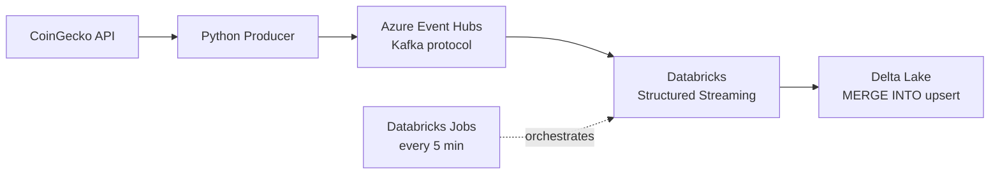

# Real-Time Market Data Lakehouse

A near-real-time cryptocurrency price pipeline built around a genuine streaming and upsert pattern, rather than a scheduled batch job.

## Overview

This project ingests live prices for five cryptocurrencies (Bitcoin, Ethereum, Solana, Cardano, Ripple) through a streaming pipeline and maintains a Delta table reflecting the current price per coin, using upsert logic rather than an append-only log.

## Architecture

A Python producer polls the CoinGecko API every 30 seconds and publishes each price as a JSON event to Azure Event Hubs, using its Kafka-compatible endpoint. Event Hubs was used in place of a locally hosted Kafka broker, since Databricks' cloud compute cannot reach services running on `localhost`; a managed cloud broker is also the standard approach in production environments.

A Structured Streaming job on Databricks consumes the events, parses the payload, and merges each micro-batch into a Delta table, maintaining a single current row per coin. The pipeline is orchestrated as a Databricks Job on a 5-minute schedule.

## Tech Stack

Python, Kafka protocol (via Azure Event Hubs), PySpark Structured Streaming, Databricks (Free Edition, serverless), Delta Lake, Databricks Jobs, Databricks Secrets.

## Key Engineering Detail: Intra-Batch Deduplication

Azure Event Hubs replays its full retention window on initial read, which meant a single micro-batch could contain multiple snapshots of the same coin. `MERGE INTO` only evaluates duplicates against records already present in the target table — it does not deduplicate records within the same incoming batch. Without handling this, the pipeline produced multiple duplicate rows per coin instead of one.

This was resolved by applying a window-function deduplication step (retaining the latest record per coin by timestamp) before each merge, along with an explicit table refresh to avoid Delta operating on a stale cached snapshot of the target table during the run.

## Other Issues Encountered

- Databricks retired Community Edition in favor of a serverless Free Edition during development, which required explicit checkpoint locations for all streaming operations and does not support continuous, always-on streaming triggers. The pipeline uses `trigger(availableNow=True)` on a schedule instead.
- Databricks' Spark-Kafka connector uses a shaded package namespace, requiring `kafkashaded.org.apache.kafka...` in the SASL configuration rather than the standard `org.apache.kafka...` path.
- Credentials are not stored in code. The Event Hubs connection string is retrieved at runtime from a Databricks secret.

## Setup

1. Create an Azure Event Hubs namespace on the Standard tier (the Kafka protocol is not supported on Basic tier).
2. Set the `COINGECKO_API_KEY` and `EVENTHUB_CONNECTION_STRING` environment variables, then run `producer.py`.
3. In Databricks, store the connection string as a secret, run the notebook, and schedule it as a Job.